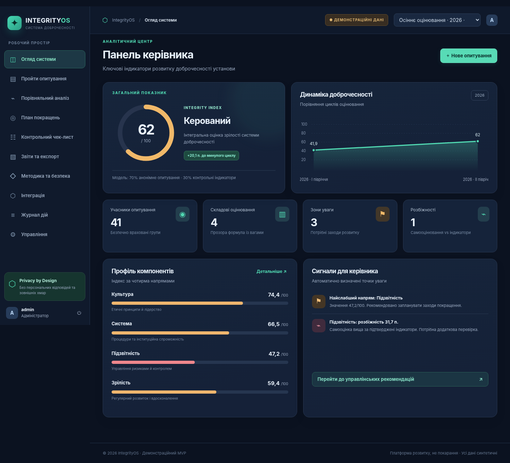

# IntegrityOS — Integrity Management Dashboard

**IntegrityOS** — демонстраційний вебзастосунок для оцінювання рівня зрілості системи доброчесності в установах сектору безпеки й оборони України. Проєкт розроблено для **завдання № 3 хакатону**. Модельний об’єкт оцінювання — вищий військовий навчальний заклад (ВВНЗ).

> **Статус:** робочий MVP для демонстрації, а не готова до промислового впровадження державна інформаційна система. Усі початкові показники — **синтетичні**. Розрахунок Integrity Index є авторською демонстраційною методикою, а не офіційним нормативним індексом. Система оцінює процеси, **не окремих людей**.

## Проблема і користувач

Результати опитувань, контрольних чек-листів і експертних оцінювань часто доводиться обробляти вручну. Це ускладнює повторні оцінювання, порівняння даних, виявлення проблемних компонентів і підготовку обґрунтованих управлінських рішень. Додатковий виклик — анонімність респондентів і розбіжність між самооцінюванням та формальним виконанням заходів.

**Для кого:** керівників установ і військових закладів освіти, аналітиків, уповноважених осіб із питань запобігання корупції та учасників анонімного оцінювання. Мета — показати сильні й слабкі сторони **системи**, визначити пріоритети вдосконалення та відстежити їх виконання.

## Що робить рішення

- Проводить цифрове анонімне опитування: **8 демонстраційних запитань**, **3 широкі категорії** респондентів, шкала **0–4**.
- Зберігає **агреговані суми оцінок і лічильники**, а не індивідуальні анкети; приховує результати груп із кількістю відповідей менш ніж **5**.
- Обчислює **Integrity Index (0–100)** і оцінки чотирьох компонентів: культура, система, підзвітність, зрілість.
- Порівнює результати опитувань із заповненим аналітиком **контрольним чек-листом** та позначає суттєві розбіжності.
- Відображає **Dashboard**, порівняльну аналітику та зміну результатів між циклами.
- Формує **пояснювані рекомендації за заздалегідь визначеними правилами**. Керівник може прийняти рекомендацію, призначити відповідального, строк і змінювати статус виконання.
- Підтримує **4 ролі** (адміністратор, керівник, аналітик, учасник), журнал управлінських дій та **експорт CSV/JSON**. PDF можна отримати через друк сторінки браузером.

**Демонстраційна формула:** для компонента `Cᵢ = 0,70 × Sᵢ + 0,30 × Eᵢ`, де `Sᵢ` — агрегована самооцінка, `Eᵢ` — чек-лист. Загальний індекс: `0,30 × Культура + 0,25 × Система + 0,30 × Підзвітність + 0,15 × Зрілість`. Повне обґрунтування і обмеження — у [`docs/METHODOLOGY.md`](docs/METHODOLOGY.md).

## Демонстрація

**Відео:** [`хакатон`](https://youtu.be/qSjQJXoYfUM) — короткий **беззвуковий огляд зі скриншотів**. Це не безперервний запис користування системою. Для конкурсної подачі бажано додати власний запис екрана із реальним проходженням сценарію (до 3 хвилин).



**Сценарій для журі:**

1. Увійти як `admin` та показати Dashboard і стартовий Integrity Index.
2. Відкрити **«Пройти опитування»**, вибрати категорію, відповісти на 8 питань і надіслати відповіді.
3. Переглянути оновлені показники й розбіжність між опитуванням і чек-листом у **порівняльній аналітиці**.
4. У ролі аналітика змінити інституційний індикатор; показати автоматичний перерахунок.
5. У ролі керівника прийняти рекомендацію, визначити відповідального та строк виконання.
6. Показати журнал дій, експорт звіту й опис методики.

У стартовому наборі є **два синтетичні цикли**, по **41 агрегованій відповіді**; показники змінюються під час демонстрації.

## Як запустити

**Потрібно:** Python **3.10+**; додаткові Python-бібліотеки для локального запуску **не потрібні**. Підключення до інтернету для роботи застосунку не потрібне.

**Windows:**

1. Завантажити та розпакувати проєкт, перейти в папку з `server.py` і `run.bat`.
2. Установити [Python](https://www.python.org/downloads/windows/) і під час інсталяції додати його до `PATH`.
3. Двічі натиснути **`run.bat`**. **Залишити консоль відкритою.**
4. Відкрити **http://127.0.0.1:8000** у браузері.

**Windows / Linux / macOS через термінал:**

```bash
python server.py
```

**Альтернатива через Docker:**

```bash
docker compose up --build
```

**Демонстраційний доступ:** `admin` / `Demo2026!`. У тестовому середовищі також є ролі `leader`, `analyst`, `participant` із тим самим демонстраційним паролем. Не використовуйте ці облікові дані в реальному середовищі. Анонімна анкета доступна без входу.

Під час першого запуску створюється `data/integrityos.sqlite` з тестовими даними. Зупинка сервера — `Ctrl+C` у терміналі. **GitHub Pages не запускає Python-бекенд**: публічний GitHub-репозиторій призначений для вихідного коду, а демонстрацію проводять локально або на окремому сервері.

**Налаштування:** підтримуються `INTEGRITY_HOST` (адреса прив'язки), `PORT` (порт HTTP) і `INTEGRITY_DB` (шлях до SQLite). Їхні **назви без значень** наведено у [`.env.example`](.env.example). Поточний код читає змінні **безпосередньо з оточення процесу** та **не завантажує `.env` автоматично**; за відсутності цих змінних використовуються значення за замовчуванням. Для локального запуску заповнювати `.env` не потрібно.

**Перевірка тестів:**

```bash
python -m unittest discover -s tests -v
```

## Як влаштовано

```text
static/index.html + static/style.css + static/app.js
                     │ браузер
                     ▼
                  server.py
          локальний HTTP + JSON API
                /           \
          model.py         store.py
       індекс і правила    SQLite, цикли,
        рекомендацій       агрегати, дії
```

- `server.py` — вебсервер, HTTP API, сесії та перевірка ролей.
- `model.py` — анкети, компоненти, формула індексу, правила рекомендацій.
- `store.py` — зберігання агрегатів та управлінських дій у SQLite.
- `static/` — адаптивний інтерфейс без зовнішніх бібліотек JavaScript.
- `tests/` — автоматичні перевірки основної логіки та API.
- `Dockerfile`, `compose.yaml` — варіант контейнерного розгортання.

API дозволяє отримувати конфігурацію, зведений Dashboard, вносити оцінки чек-листа та управляти заходами. Це **можливість подальшої інтеграції**, а не твердження про підключення до наявних відомчих систем.

**Межі захисту MVP:** не зберігаються персональні анкети; застосовується поріг групи `k=5` і рольовий доступ до управлінських функцій. Прототип **не гарантує повної анонімності** при порівнянні послідовних публікацій агрегатів і не має захисту від повторних анонімних подань. Перед реальним використанням потрібні незалежна перевірка безпеки, TLS, промислова автентифікація, захист від повторної подачі й затвердження методики.

## Документація

- [`docs/METHODOLOGY.md`](docs/METHODOLOGY.md) — методика розрахунку Integrity Index, шкали та пороги.
- [`docs/SECURITY_AND_ETHICS.md`](docs/SECURITY_AND_ETHICS.md) — анонімність, ризики зловживань, етичні обмеження.
- [`docs/INTEGRATION.md`](docs/INTEGRATION.md) — архітектура та можливі сценарії інтеграції.
- [`docs/API.md`](docs/API.md) — HTTP API та доступ за ролями.
- [`docs/TIME_SAVINGS.md`](docs/TIME_SAVINGS.md) — **модельний**, не виміряний на практиці розрахунок економії часу.
- [`docs/AI_USAGE.md`](docs/AI_USAGE.md) — опис використання ШІ, який команда має перевірити перед поданням.
- [`docs/PITCH_SCRIPT.md`](docs/PITCH_SCRIPT.md) — сценарій виступу та відповідей журі.
- [`docs/SUBMISSION.md`](docs/SUBMISSION.md) — публікація GitHub-репозиторію та подання.

## Що використали

**Технології:** Python (стандартна бібліотека, `http.server`), SQLite, HTML, CSS, JavaScript, HTTP/JSON API, Docker / Docker Compose для альтернативного запуску, `unittest` для тестів. Під час роботи запущеного MVP **немає зовнішніх AI API, npm-пакетів або обов’язкових хмарних сервісів**.

**Методичний орієнтир:** [«Рекомендації щодо трансформації функціонування ВВНЗ (ВНП ЗВО) на засадах доброчесності та нульової толерантності до корупції»](https://nuou.org.ua/assets/documents/recommendations_transform_dobrochesnist.pdf), насамперед додатки **Б** і **В**. Для MVP взято скорочені демонстраційні питання й окремі індикатори, а не повну методику оцінювання.

**ШІ під час розроблення:** ChatGPT (OpenAI) застосовувався для допомоги зі структурою, кодом, тестуванням і документацією. Безпосередньо **оцінювання та рекомендації працюють за явними правилами**, а не за відповідями генеративної моделі. Деталі — [`docs/AI_USAGE.md`](docs/AI_USAGE.md); перед здачею потрібно привести опис у відповідність до фактичного внеску команди й політики організаторів.
